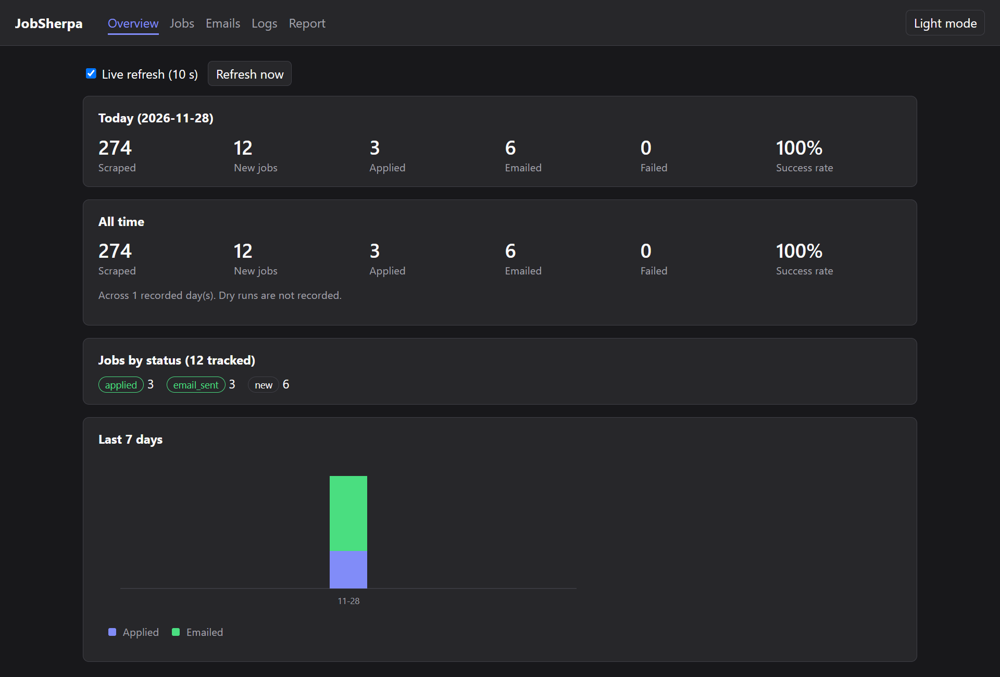
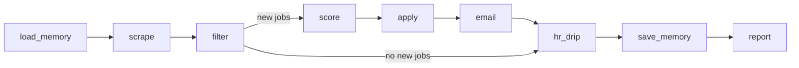
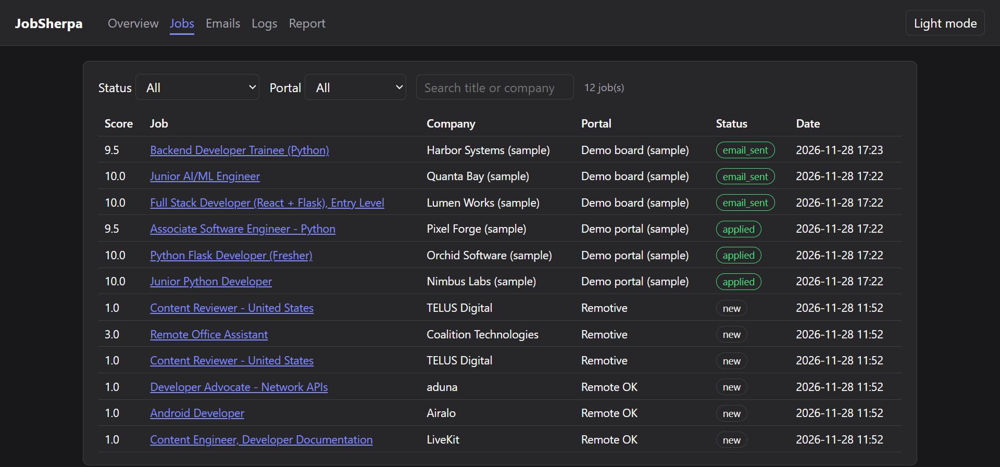
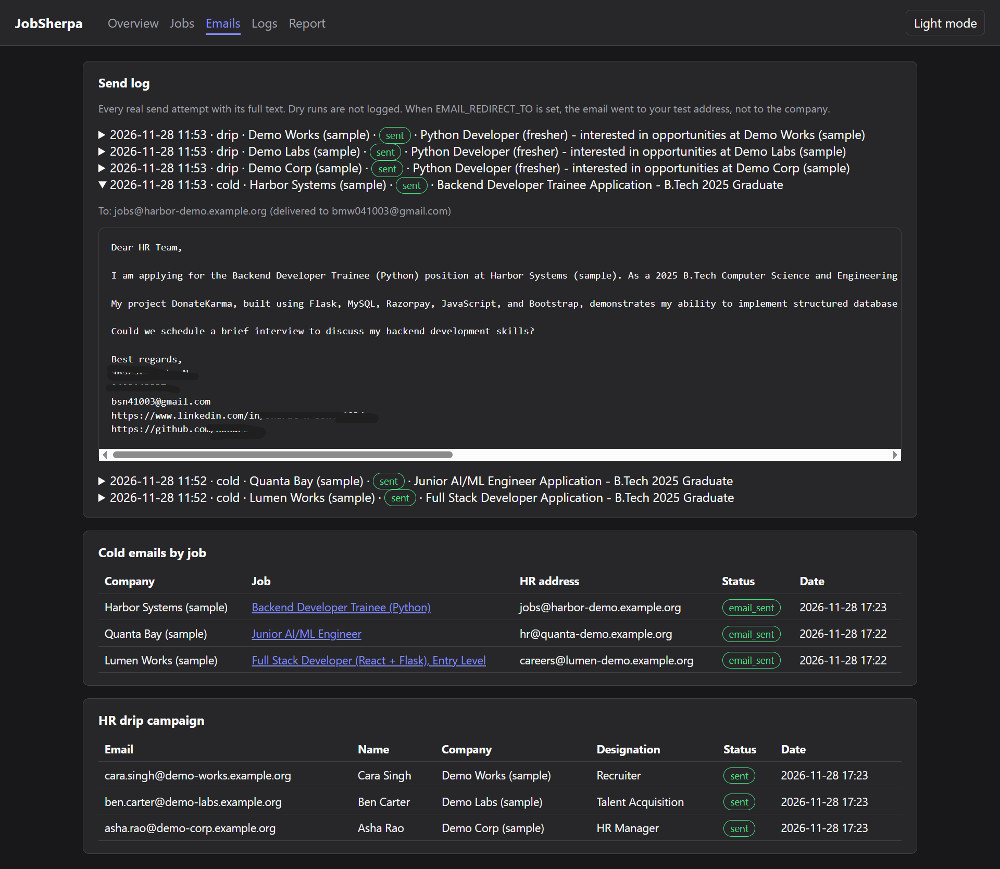
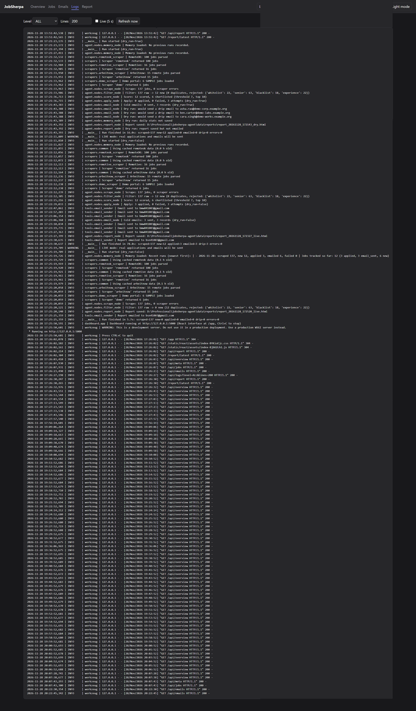
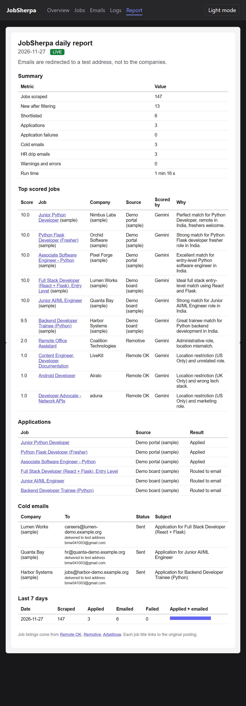
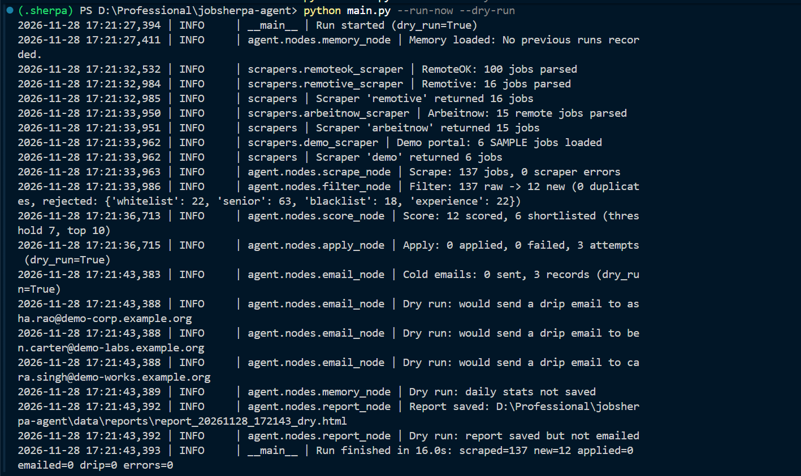
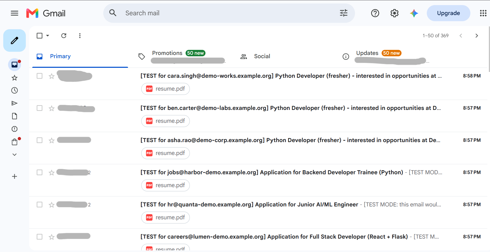

# JobSherpa: An Autonomous Multi-Agent Job Search and Application System

JobSherpa scrapes job portals, filters and deduplicates the results, scores jobs against a candidate profile with an LLM, applies automatically where a portal supports it, and writes personalised cold emails for the rest. It runs daily on a schedule and sends an HTML summary report. A local dashboard shows everything that happened.



## How it works



Each box is a LangGraph node that reads and writes one shared `AgentState`. If the filter finds no new jobs, scoring, applying and job emails are skipped and the run goes straight to the HR drip campaign.

| Stage | What it does |
|---|---|
| load_memory | Creates tables, recovers jobs left `in_progress` by a crash, summarises recent runs |
| scrape | RemoteOK, Remotive and Arbeitnow (public JSON APIs), plus an optional labelled demo portal. One failing scraper never stops the others |
| filter | Blacklist, seniority, years-of-experience and whitelist rules (whole-word matching) and SHA-256 URL deduplication in SQLite |
| score | One batched Gemini prompt returns 0 to 10 scores as JSON. Backoff on 429 and 503 errors, model fallback, keyword fallback |
| apply | Playwright fills and submits simple application forms on supported portals. Anything else is routed to email |
| email | HR address discovery (cache, role addresses, MX validation), Gemini-written emails with a template fallback, Gmail SMTP with the resume attached |
| hr_drip | Emails a small daily batch from a CSV contact list, each contact once |
| save_memory | Adds the day's numbers to `daily_stats` (real runs only) |
| report | Builds an HTML report, saves it, and emails it on live runs |

## Safety features

- **Dry-run is the default.** Nothing is applied or sent unless you pass `--live` or set `DRY_RUN=false`.
- **`EMAIL_REDIRECT_TO`** sends every email to your own address while testing. A live run with it empty also needs `--yes`.
- **Claim before acting.** A job is marked `in_progress` before the browser opens or an email is sent. A crashed run leaves it as `manual_required`, never retried.
- **Duplicate protection** for jobs, HR addresses and drip contacts, plus daily limits that count earlier runs.
- **Jobs scored by the keyword fallback are not shortlisted** unless `ALLOW_FALLBACK_SHORTLIST=true`.
- **No secrets in Git:** `.env`, the real profile, the resume, databases and logs are ignored.

## Setup (Python 3.13)

```powershell
git clone <your repository URL>
cd jobsherpa-agent
python -m venv .venv
.venv\Scripts\Activate.ps1
pip install -r requirements.txt
playwright install chromium
Copy-Item .env.template .env
Copy-Item user_profile.example.json user_profile.json
```

1. Edit `.env` (see below) and `user_profile.json` with your real details.
2. Put your resume at `data/resume.pdf`.
3. Optional: create `data/hr_contacts.csv` with the columns `name,email,company,designation`.
4. Get a free Gemini API key from Google AI Studio and a Gmail App Password (this needs 2-Step Verification).

### Important settings (full list in `.env.template`)

| Variable | Purpose |
|---|---|
| `GEMINI_API_KEY`, `GEMINI_MODEL`, `GEMINI_FALLBACK_MODELS` | LLM access and fallback models |
| `GMAIL_ADDRESS`, `GMAIL_APP_PASSWORD`, `REPORT_EMAIL` | Sending and the report recipient |
| `EMAIL_REDIRECT_TO` | Test address that receives every outgoing email |
| `DRY_RUN`, `SCHEDULE_TIME`, `TIMEZONE` | Default mode and daily schedule |
| `JOB_SCORE_THRESHOLD`, `TOP_N_JOBS` | Which scored jobs are shortlisted |
| `MAX_APPLY_PER_DAY`, `MAX_COLD_EMAILS_PER_DAY`, `DAILY_EMAIL_LIMIT`, `DRIP_BATCH_SIZE` | Daily limits |
| `BLACKLIST_KEYWORDS`, `WHITELIST_KEYWORDS`, `SENIOR_KEYWORDS`, `MAX_YEARS_REQUIRED` | Filter rules |
| `AUTO_APPLY_PORTALS`, `ENABLE_DEMO_PORTAL` | Which portals Playwright applies on, and the sample portal switch |
| `DATABASE_PATH` | SQLite file (use a separate file for demos) |

## Usage

```powershell
python main.py --run-now --dry-run   # full pipeline, nothing sent or applied
python main.py --run-now --live      # real actions (use EMAIL_REDIRECT_TO while testing)
python main.py                       # scheduler: runs daily at SCHEDULE_TIME
python main.py --dashboard           # dashboard at http://127.0.0.1:5000 (React UI at /app)
python -m tests.run_all              # run every test module
```

Logs go to `logs/jobsherpa.log` (a new file every midnight, 30 kept). Reports are saved in `data/reports/`.

## Dashboard

The Flask app has Overview, Jobs, Emails, Logs and Report pages, plus a JSON API under `/api`. A React interface (source in `dashboard/frontend`, built into `dashboard/static/react`) is served at `/app` with live refresh, sortable jobs, a trend chart and dark mode. To rebuild it: `cd dashboard/frontend; npm install; npm run build`.






## Test evidence

1. **Successful dry-run output**
   
2. **Jobs scored by the LLM, with numeric scores:** see the score table in the [report screenshot](docs/screenshots/report.png).
3. **Sample generated cold email:** see the expanded email in the [Emails screenshot](docs/screenshots/emails.png).
4. **Rendered HTML summary report, as received by email**
   

Automated test results for every module: [docs/test-evidence/test-results.txt](docs/test-evidence/test-results.txt)

## Project structure

```
agent/       LangGraph graph, state, nodes, scoring, filtering, emailing, report
scrapers/    one file per portal, plus the registry
tools/       email finder, email sender, HR CSV reader, Playwright applier
database/    db_manager.py (all SQLite code)
dashboard/   Flask app, templates, React frontend
demo/        labelled sample jobs and a local sample application form
tests/       one module per component (python -m tests.run_all)
```

## Limitations

- RemoteOK, Remotive and Arbeitnow are aggregators that list few fresher roles. Real runs often find only a handful of suitable jobs, which is why the labelled demo portal exists.
- HR addresses are role addresses (`hr@`, `careers@`) on a guessed company domain. MX validation shows the domain accepts mail, not that the mailbox exists. The Apollo/Snov lookup step is a placeholder.
- Playwright applies only on simple HTML forms. Forms with unknown required fields, consent boxes or CAPTCHAs become `manual_required`. It runs against the local demo form.
- Jobs scored while Gemini is unavailable are marked as seen and are not retried the next day.
- LinkedIn and Naukri are not scraped, because their terms restrict automation.

## Data sources and credits

Job listings come from [Remote OK](https://remoteok.com), [Remotive](https://remotive.com) and [Arbeitnow](https://www.arbeitnow.com). Each job keeps a link to its original posting. The overall architecture follows the walkthrough given by the course mentor at Technex Cloud Networks (no code copied).

## AI assistance

[Write this to match TCN's rules. Example: "I used AI assistants (Claude) for design discussion, code drafts, review and debugging. I ran, tested and reviewed all code and can explain every module."]